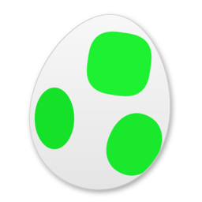

  

# DinoTale — Android

The Android version of [DinoTale](https://github.com/wootbeer/dinotale) (Yoshi's Story, statically recompiled):
the game running natively on Android with touch buttons, full controller support and RetroArch shaders. Made for
Android handhelds with a built-in controller and for phones. Tested on the **AYN Odin 2 Portal** (Snapdragon 8
Gen 2, 1920×1080, Android 13).

This repository is a fork of the main project: branch `main` follows upstream, branch `android` (the default) is
the Android port. The main project's README (Windows, Linux, display options) is kept as
[README-UPSTREAM.md](README-UPSTREAM.md).

> ⚠️ **No game files.** The app contains only this project's code. You need your own legally obtained copy of
> **Yoshi's Story (USA) (En,Ja)** — any byte order (`.z64`, `.n64`, `.v64`), also inside a `.zip` or `.7z`;
> SHA-1 of the `.z64`: `b13072fef6c6df48c07d8822c01e5bc59036f6da`.

## Install

1. Download the `.apk` from the [Releases](../../releases) page and open it on the device (allow installing apps
   from your browser or file manager when Android asks).
2. Start **DinoTale** and choose **Load ROM**: Android's file picker opens; pick your copy of the game. It is
   checked and copied into the app; the app restarts once to finish setting up.

Updates install over the previous version and keep your saves. To get them automatically, add this repository to
[Obtainium](https://github.com/ImranR98/Obtainium) (`https://github.com/almost-drowned-rat/dinotale-Android`).

Needs Android 8.0 or newer, a 64-bit (arm64) device and a GPU with Vulkan. App ID
`io.github.almostdrownedrat.dinotale`.

## Controls

- **Controller**: works out of the box (built-in handheld controls or a Bluetooth / USB pad); set it up in the
  game's settings (Controls).
- **Touch buttons** (N64 layout: stick, A, B, Z, L, R, START, C buttons; D-pad hidden by default). **Automatic**
  hides them while a controller is used and a touch brings them back; **Always** and **Off** are the other modes.
- **Back** (the back gesture, the system bar's back button or a handheld's own Back key) opens the menu over the
  game; Back again closes it.

## Menu

One menu for everything — the game's settings and the Android ones — laid out the same in all of these N64 Android
ports: the sections in a column on the left, the settings as cards on the right, grouped under headings and marked
in the game's colour (green, as its start screen).

- **Controller**: D-pad / stick move, **A** select (on a value **A** takes it, left / right change it, **A** or **B**
  lets go), **B** one level back (from the section column it closes the menu), **Y** back to the default,
  **L / R** the section. The hints are at the bottom right.
- **Touch**: tap a card, swipe to scroll; on a value a tap on its left third steps back, on the rest forward.

The sections:

- **General** — Back to game, Exit game; Background Input Mode
- **Gameplay** — Cheats (with Yoshi Colour) and Hacks (with Custom Codes and the GameShark Button)
- **Graphics** — picture, quality (also the main project's display options: aspect ratio, texture filtering,
  hybrid dimming), frame rate (with the FPS readout) and the GPU driver; graphics changes are applied with
  **Apply** at the bottom
- **Shaders**, **Audio**
- **Controls** — Button mapping, deadzone, rumble; the touch buttons (mode, move and resize, size, single buttons,
  opacity, stick sensitivity, reset)
- **Mods** — Manage mods (before the game starts). In the game, **Install / switch mods (restart)** restarts the
  app to the start screen, where mods are installed and turned on or off.

There are no window mode options (always full screen), and Lossless Scaling frame generation isn't available (it
needs the Windows `Lossless.dll`).

### Shaders and GPU driver

- **Shaders** — RetroArch shaders (librashader, drawn by RT64). None are shipped: **Import shader pack (.zip)** takes a slang
  shader pack such as [libretro/slang-shaders](https://github.com/libretro/slang-shaders)' "Download ZIP"; pick a
  preset by folder and change its parameters (kept per preset). **Shader Resolution**: **Original** (the N64's
  240 lines, as in RetroArch — the look the shaders were made for and by far the lightest), **2x** or **Full**.
- **Graphics > Driver > GPU Driver (Turnip)** — pick one of the installed drivers, **Install driver (.zip)** or
  **Use system driver**; the app restarts.

## Known issues

Report problems on this repository's [Issues](../../issues) page, with the device, Android version and GPU driver.
Problems of the game itself (also on the PC) belong to the [main project](https://github.com/wootbeer/dinotale/issues).

## Building

On Linux: generate the game code from your own ROM as described in [BUILDING.md](BUILDING.md) (N64Recomp,
RSPRecomp; the host configure applies `lib-patches/`), build `lib/rt64/src/tools/file_to_c` for the host, apply
the patches in [android/patches](android/patches) to the submodules (`git -C <submodule> apply`), then build the
APK with `./gradlew assembleRelease -PHOST_FILE_TO_C=<path to file_to_c>` in `android/` (NDK, JDK 21).

## AI assistance

The Android port and the shader support were made with AI assistance ([Claude Code](https://claude.com/claude-code)).
Planning, testing on the device and the decision what gets released are by the repository owner. Use at your own
risk.

## Credits and license

- [wootbeer/dinotale](https://github.com/wootbeer/dinotale) — DinoTale (see [README-UPSTREAM.md](README-UPSTREAM.md)
  for its own credits: the Yoshi's Story decompilation, splat, spimdisasm, rabbitizer, Fredoka)
- [deivid22srk/dk64-recomp-android](https://github.com/deivid22srk/dk64-recomp-android) — the Android layer
  (NDK build, SDLActivity integration, SAF file bridge, libadrenotools / Turnip, lifecycle)
- [N64Recomp](https://github.com/N64Recomp/N64Recomp) and [N64ModernRuntime](https://github.com/N64Recomp/N64ModernRuntime)
  by Mr-Wiseguy, [RecompFrontend](https://github.com/N64Recomp/RecompFrontend)
- [RT64](https://github.com/rt64/rt64) by Dario (DarioSamo), with [plume](https://github.com/renderbag/plume)
- [librashader](https://github.com/SnowflakePowered/librashader) by SnowflakePowered (MPL-2.0 / GPL-3.0)
- [libadrenotools](https://github.com/bylaws/libadrenotools) by bylaws — custom Vulkan drivers
- [SDL2](https://www.libsdl.org/), [RmlUi](https://github.com/mikke89/RmlUi) and the other libraries in the
  submodules

License: GPL-3.0, see [COPYING](COPYING). The game itself remains the property of its rights holders.

*Fan project, not affiliated with Nintendo.*
